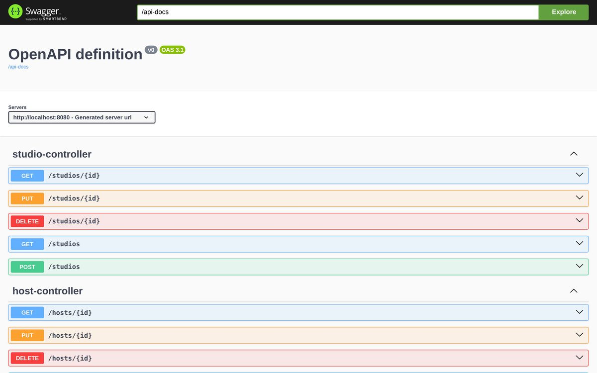

# CodeCast API

REST API for booking podcast recording studios: studios, hosts and bookings, with time-conflict detection that works across time zones.

Built with Java 21 and Spring Boot as the technical challenge that got me into a client project at CODE Jr.



## Highlights

- **Conflict detection:** a custom JPQL query rejects a booking when it overlaps another one in the same studio (one starts before the other ends and ends after the other starts).
- **Time zones:** each booking carries its time zone; times are converted to UTC before being stored, so bookings made from different zones are compared correctly.
- **Layered architecture:** controller → service → repository, with request/response DTOs that keep JPA entities out of the API.
- **Consistent errors:** a global `@RestControllerAdvice` returns every error as `{ status, message, timestamp }`.
- **Interactive docs:** every endpoint is documented and testable in Swagger UI.

## Stack

Java 21 · Spring Boot · Spring Data JPA · H2 (in-memory) · Lombok · springdoc-openapi

## Run locally

Requires JDK 21.

```bash
git clone https://github.com/kauaazn/codecast-api.git
cd codecast-api/codecast
./mvnw spring-boot:run      # Windows: mvnw.cmd spring-boot:run
```

- API: `http://localhost:8080`
- Swagger UI: `http://localhost:8080/swagger-ui/index.html`
- H2 console: `http://localhost:8080/h2-console` (JDBC URL `jdbc:h2:mem:codecastdb`, user `sa`, empty password)

## Endpoints

| Resource | Routes |
| --- | --- |
| Studios | `POST /studios` · `GET /studios` · `GET /studios/{id}` · `PUT /studios/{id}` · `DELETE /studios/{id}` |
| Hosts | `POST /hosts` · `GET /hosts` · `GET /hosts/{id}` · `PUT /hosts/{id}` · `DELETE /hosts/{id}` |
| Bookings | `POST /bookings` · `GET /bookings` · `GET /bookings/{id}` · `DELETE /bookings/{id}` |

Example booking:

```json
POST /bookings
{
  "studioId": 1,
  "hostId": 1,
  "recordingDate": "2026-07-01",
  "startTime": "14:00",
  "endTime": "16:00",
  "timezone": "America/Sao_Paulo"
}
```

## Repository layout

```
codecast/        Spring Boot API (README, technical report, source)
frontend-app/    React interface for studios, hosts and bookings
```

More detail on the design decisions is in the [technical report](codecast/REPORT.md) (Portuguese).

## Next steps

- PostgreSQL with versioned migrations instead of in-memory H2
- Unit and integration tests for the conflict rules
- Authentication for producers
